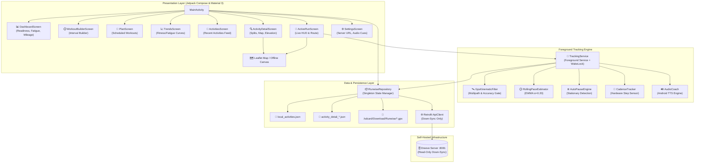

# Runwise Android Companion 🏃📱

> **Modern, privacy-first Android companion app and standalone running computer designed for endurance athletes, self-hosted Dreeve homelabs, and structured interval training.**

[-brightgreen.svg)](https://developer.android.com/)
[](https://kotlinlang.org/)
[](https://developer.android.com/jetpack/compose)
[](#architectural-invariants)
[](LICENSE)

---

## ⚡ What Is Runwise?

**Runwise Android** is a dedicated athletic companion app that bridges the gap between self-hosted fitness tracking (Dreeve homelab server) and real-time on-road execution. It serves two distinct roles:

1. **Athlete Dashboard & Training Down-Sync**: Fetches readiness scores, historical smartwatch activities, aerobic fitness/fatigue curves, and planned workouts from your self-hosted Dreeve instance.
2. **Strava-Grade Standalone GPS Running Computer**: Features a high-precision foreground tracking engine, kinematic GPS filtering, auto-lapping interval workouts, disciplined voice coaching, and local GPX export.

---

## 🏛️ Architectural Invariants

### 1. Strictly Down-Sync (Zero Server Pollution)
Workouts recorded on the phone app are **NEVER** posted to the Dreeve server via HTTP POST. The smartwatch remains the single source of truth for historical homelab fitness logs. Phone-recorded activities are saved strictly to on-device JSON caches and exported as standard `.gpx` files in `/sdcard/Download/Runwise/`.

### 2. No Barometer Hardware Invariant
Designed for devices lacking barometric altimeters (e.g. Redmi Note 8 Pro). Elevation gain is computed exclusively from raw GPS altitude fixes passed through:
- A multipath altitude jump filter ($|\Delta \text{alt}| > 25\text{m/s}$ rejection)
- A 15-second low-pass Exponential Moving Average ($\alpha = 0.15$)
- A 2.0-meter climbing hysteresis threshold

### 3. Clear Separation: Audio Cues vs. Kilometer Splits vs. Structured Laps
- **500m Intermediate Audio Cues**: Voice-only feedback (*"Last 500 meters, 5:45 pace"*). It **never** creates an artificial lap or alters metric split data.
- **True Kilometer Splits**: Exactly 1.00 km milestones with split pace and heart rate metrics.
- **Structured Interval Auto-Lapper**: Cuts discrete laps matching structured steps (`WARMUP`, `INTERVAL`, `RECOVERY`, `COOLDOWN`).

---

## 📱 Feature Matrix

| Module | Features & Capabilities |
| :--- | :--- |
| **Tracking Engine** | 1 Hz `FusedLocationProviderClient`, `GpsKinematicFilter` multipath rejection, zero-speed stationary drift suppression, auto-pause. |
| **Pace Estimation** | Exponentially Weighted Moving Average (`RollingPaceEstimator`, $\alpha = 0.20$) eliminating erratic GPS instant pace spikes. |
| **Cadence Tracker** | Step-sensor hardware listener and fallback accelerometer peak-detection for accurate SPM (Steps Per Minute). |
| **Audio Coach** | Disciplined voice feedback via Android TTS (target pace delta warnings, step countdowns, 500m progress cues). |
| **Workout Builder** | Visual interval creation, repeating sets (e.g., $4 \times 1\text{km}$ @ 6:15), target pace ranges, warm-up/cool-down flexibility. |
| **Interactive Map** | Embedded Leaflet WebView with dark-mode OpenStreetMap tiles, dynamic zoom, and offline vector canvas fallback. |
| **Post-Run Analysis** | Complete route map, elevation profile, metric kilometer splits table, interval repetition breakdown, and GPX export. |
| **Dreeve Sync** | Automated background sync of athlete readiness, fatigue, and recent activities from your self-hosted server (`:8081`). |

---

## 🏗️ System Architecture



---

## 📁 Repository Structure

```text
runwise-android/
├── app/
│   ├── build.gradle.kts           # App module dependencies & SDK configuration
│   └── src/main/
│       ├── AndroidManifest.xml    # Permissions (Fine Location, Background, WakeLock, TTS)
│       └── java/com/runwise/app/
│           ├── RunwiseApplication.kt     # App entry point & repository initialization
│           ├── MainActivity.kt           # Navigation host & Compose scaffold
│           ├── coach/
│           │   ├── AudioCoach.kt         # Disciplined voice coaching engine
│           │   └── CadenceTracker.kt     # Step sensor listener & SPM calculator
│           ├── data/
│           │   ├── api/                  # Retrofit API interface & client
│           │   ├── model/                # Workout, sync, and activity models
│           │   └── repository/           # Offline-first repository & GPX serialization
│           ├── service/
│           │   ├── TrackingService.kt    # Foreground service controller
│           │   └── engine/
│           │       ├── AutoPauseEngine.kt       # Kinetic velocity auto-pause
│           │       ├── GpsKinematicFilter.kt    # Accuracy & multipath filter
│           │       ├── HardwareSpeedCache.kt    # Speed circular buffer
│           │       └── RollingPaceEstimator.kt  # Smoothed EWMA pacing
│           ├── ui/
│           │   ├── active/               # Live workout tracking HUD
│           │   ├── activities/           # Feed & workout detail screens
│           │   ├── components/           # LeafletMapView & canvas widgets
│           │   ├── dashboard/            # Athlete readiness & volume cards
│           │   ├── workout/              # Structured workout builder
│           │   ├── plan/ & trends/       # Training schedules & fitness curves
│           │   └── theme/                # Material 3 dark palette
│           └── util/
│               ├── AnalyticsEngine.kt    # Post-run metrics & heart rate distribution
│               ├── PlanWorkoutParser.kt  # Grammar parser for interval descriptions
│               └── PolylineUtils.kt      # Google Polyline encoder/decoder
├── build.gradle.kts               # Top-level build configuration
├── gradle/wrapper/                # Gradle wrapper (Gradle 8.7)
├── gradlew                        # Build script for Linux/macOS
├── RUNWISE_TECHNICAL_SPECIFICATION.md # Full 476-line engineering & hardware RFC
└── README.md                      # This comprehensive overview & setup guide
```

---

## 🛠️ Building & Running

### Prerequisites
- **JDK 17+**: `sudo apt install openjdk-17-jdk` (Linux) or via Homebrew/SDKMAN.
- **Android SDK**: Build tools 34.0.0, Compile SDK 34 (Android 14).
- **Gradle**: Uses the bundled Gradle wrapper (v8.7).

### 1. Build Debug APK
```bash
cd ~/projects/runwise-android
./gradlew assembleDebug
```
The compiled APK will be generated at:
```text
app/build/outputs/apk/debug/app-debug.apk
```

### 2. Sideload to Phone via ADB
Ensure USB debugging is enabled on your device:
```bash
adb devices
./gradlew installDebug
# Or manually via adb:
adb install -r app/build/outputs/apk/debug/app-debug.apk
```

---

## ⚙️ Configuration & First Run

1. **Grant Permissions**:
   - Location: Select **Allow all the time** (required for foreground GPS recording).
   - Physical Activity: Select **Allow** (required for hardware step cadence).
   - Battery: In Android App Info &rarr; Battery &rarr; Select **Unrestricted**.
2. **Configure Dreeve Server Sync**:
   - Open **Settings** inside the app.
   - Enter your Dreeve server URL (e.g., `http://dreeve.home:8081` or your LAN IP).
   - Pull down on the **Dashboard** to trigger the initial athlete profile sync.
3. **Structured Interval Run**:
   - Tap **Workouts** &rarr; Select or create a structured interval plan (e.g. $4 \times 1\text{km}$ @ 6:15).
   - Tap **Start Run**. The audio coach will count down and guide each interval with voice prompts.
4. **Export GPX**:
   - Upon finishing, the full GPX file is written to `/sdcard/Download/Runwise/<workout_name>.gpx` for instant import into Strava or Dreeve.

---

## 📖 Deep Technical Specification

For the complete 476-line engineering specification detailing mathematical smoothing equations, GPS rejection filters, down-sync schemas, and hardware invariants, read:

👉 **[RUNWISE_TECHNICAL_SPECIFICATION.md](RUNWISE_TECHNICAL_SPECIFICATION.md)**

---

## ⚖️ License

Distributed under the MIT License. See [LICENSE](LICENSE) for details.
