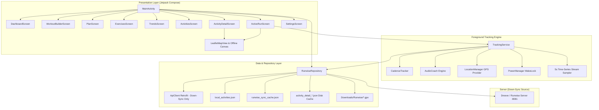

# RUNWISE ANDROID COMPANION: COMPLETE FUNCTIONAL & ARCHITECTURAL SPECIFICATION

> **Document Version:** 2.1.0 (Production Architecture & Telemetry Correction)  
> **Target OS:** Android 14 (API 34)  
> **Repository Location:** `projects/runwise-android`  
> **Package Name:** `com.runwise.app` / `com.runwise.app.debug`  
> **Hardware Configuration:** Smartwatch (NoiseFit / FIT file sync to Dreeve server) + Smartphone internal sensors (GPS, Accelerometer / Step Detector). **Hardware Invariant: No device possesses a barometric altimeter sensor.**  
> **Companion App Role:** Strictly Down-Sync Athlete Dashboard, Structured Workout HUD & Standalone Local Activity Recorder with GPX Export  

---

## 1. ARCHITECTURAL MANDATES & CORE INVARIANTS

### 1.1 Zero Server Pollution (Strictly Down-Sync Architecture)
- The user's primary historical workout recorder is their **smartwatch** (ColorFit / NoiseFit), which transfers FIT files via the cloud bridge into the Dreeve homelab server.
- The phone companion app communicates with the Dreeve backend **strictly in a DOWN-SYNC capacity** (fetching athlete profile, training plans, readiness metrics, fitness/fatigue curves, and smartwatch activities).
- When recording an activity directly on the phone companion app (e.g., outdoor run, base run, walk, hike):
  - **The workout is NEVER uploaded to the server via HTTP POST.**
  - All metrics, GPS breadcrumbs, time-series streams, laps, and splits are written directly to local on-device files:
    - Feed registry: `filesDir/local_activities.json`
    - Full telemetry cache: `cacheDir/activity_detail_<id>.json`
    - Memory cache: `RunwiseRepository.detailMemoryCache`
    - Standard GPX export: `context.getExternalFilesDir(null)/Runwise/<id>.gpx` and `/sdcard/Download/Runwise/<SafeName>.gpx`
  - Deleting a phone recording purges local files only and never contacts the server.

### 1.2 No Barometer Sensor Invariant
- **Hardware Fact:** Neither the smartphone (Redmi Note 8 Pro) nor the wearable possesses a hardware barometric pressure sensor.
- **Elevation Algorithm:** Elevation gain is computed **exclusively** from GPS altitude fixes processed through a multipath spike filter, a 15-second low-pass Exponential Moving Average (EMA) smoother ($\alpha = 0.15$), and a 2.0-meter climbing hysteresis barrier.
- Raw barometric pressure listeners or simulated barometers are strictly prohibited.

### 1.3 Semantic Differentiation: Audio Cues vs. Kilometer Splits vs. Structured Intervals
1. **The 500m Milestone is an Audio Cue ONLY:**
   - The 500m intermediate alert is strictly a voice announcement (*"Last 500 meters, [Pace]"*) designed for runner pacing feedback.
   - It **must NEVER** cut a lap, reset `lapDistanceMeters`, or append a `LapSnapshot` to `completedLaps`.
   - Non-interval workouts (Base run, Zone 2 run, Easy run, Tempo, Free run) have zero 500m laps and **must NEVER display the `WorkoutLapsAnalysisSection`**.
2. **Structured Interval Workouts:**
   - Workouts with explicit interval steps define step types: `WARMUP`, `INTERVAL`, `RECOVERY`, `COOLDOWN`.
   - Only workouts containing actual interval steps display the `WorkoutLapsAnalysisSection`.
   - Only active high-intensity interval repetitions receive the `"INTERVAL"` badge (`isInterval = true`).
3. **True Kilometer Splits (`KilometerSplitsSection`):**
   - Represents metric kilometer milestones (Split 1 = `1.00 km`, Split 2 = `1.00 km`, Split 3 = `0.55 km` partial remainder).
   - A 2.55 km run produces **exactly 3 split rows** (two 1.0 km splits + one 0.55 km remainder). Sub-splits (such as 500m segments) must NEVER be displayed as kilometer splits.

---

## 2. SYSTEM TOPOLOGY & COMPONENT INTERACTION GRAPH



---

## 3. EXHAUSTIVE COMPONENT-BY-COMPONENT SPECIFICATION

### 3.1 Application Entry: `RunwiseApplication.kt`
- **Path:** [`app/src/main/java/com/runwise/app/RunwiseApplication.kt`](app/src/main/java/com/runwise/app/RunwiseApplication.kt)
- **Extends:** `android.app.Application`
- **Responsibilities:**
  - Singleton bootstrap: Initializes `RunwiseRepository.getInstance(this)` on process startup.
  - Non-blocking startup refresh: Dispatches `repository.sync()` in an IO coroutine to refresh training plans, readiness models, and smartwatch activities from the server without delaying UI launch.

---

### 3.2 Navigation & Coordinator: `MainActivity.kt`
- **Path:** [`app/src/main/java/com/runwise/app/MainActivity.kt`](app/src/main/java/com/runwise/app/MainActivity.kt)
- **Extends:** `ComponentActivity`
- **Responsibilities:**
  - Dynamic Runtime Permission Verification:
    - `ACCESS_FINE_LOCATION` & `ACCESS_COARSE_LOCATION`
    - `ACTIVITY_RECOGNITION` (API 29+)
    - `POST_NOTIFICATIONS` (API 33+)
  - Compose Navigation Stack: Manages 6 primary destinations:
    1. `dashboard` (`DashboardScreen`)
    2. `workouts` (`WorkoutBuilderScreen`)
    3. `exercises` (`ExercisesScreen`)
    4. `trends` (`TrendsScreen`)
    5. `activities` (`ActivitiesScreen`)
    6. `settings` (`SettingsScreen`)
  - Full-Screen HUD Takeover:
    - Observes `TrackingService.runState`.
    - If `isRunning == true` or `isPreStart == true`, hides bottom navigation bar and renders `active_run` (`ActiveRunScreen`).
  - Structured Workout Dispatch:
    - Serializes structured `CustomWorkout` to Moshi JSON and starts `TrackingService` with action `ACTION_PREPARE`.

---

### 3.3 Core Tracking Engine: `TrackingService.kt`
- **Path:** [`app/src/main/java/com/runwise/app/service/TrackingService.kt`](app/src/main/java/com/runwise/app/service/TrackingService.kt)
- **Type:** Android `Service` (Foreground type: `location`)
- **Implements:** `LocationListener`

#### State Data Class `RunState`
```kotlin
data class RunState(
    val isRunning: Boolean = false,
    val isPaused: Boolean = false,
    val isPreStart: Boolean = false,
    val gpsStatus: GpsStatus = GpsStatus.SEARCHING, // SEARCHING, LOCKED, DISABLED
    val gpsAccuracyMeters: Float = 999f,
    val currentLatitude: Double = 0.0,
    val currentLongitude: Double = 0.0,
    val currentAltitudeMeters: Double = 0.0,
    val distanceMeters: Int = 0,
    val movingTimeSeconds: Long = 0L,
    val elapsedTimeSeconds: Long = 0L,
    val currentPaceSecPerKm: Int = 0,
    val averagePaceSecPerKm: Int = 0,
    val targetPaceSecPerKm: Int = 375, // Target pace from workout step (e.g. 6:15 min/km)
    val paceToleranceSec: Int = 25,    // Anti-chatter tolerance (±25s for base runs)
    val currentCadenceSpm: Int = 0,
    val averageCadenceSpm: Int = 0,
    val currentLapNumber: Int = 1,
    val totalLapsCount: Int = 1,
    val currentStepTitle: String = "Lap 1",
    val stepType: StepType = StepType.RUN,
    val stepTargetDistanceMeters: Int = 0,
    val stepTargetDurationSeconds: Int = 0,
    val lapDistanceMeters: Int = 0,
    val lapTimeSeconds: Long = 0L,
    val lapPaceSecPerKm: Int = 0,
    val elevationGainMeters: Int = 0,
    val calories: Int = 0,
    val routePoints: List<Pair<Double, Double>> = emptyList(),
    val completedLaps: List<LapSnapshot> = emptyList(),
    val sportType: String = "Run",
    val workoutType: String = "Outdoor Run"
)
```

#### Detailed Tracking Logic & Algorithms:

1. **Pre-Start GPS Acquisition Engine:**
   - Initiated via `ACTION_PREPARE`. Acquires `PowerManager.PARTIAL_WAKE_LOCK`.
   - Requests location updates with `minTimeMs = 1000L`, `minDistanceM = 1.0f`.
   - Filters incoming fixes:
     - If `location.accuracy <= 20.0f`: transitions `GpsStatus.SEARCHING` $\rightarrow$ `GpsStatus.LOCKED`.
     - Speaks voice cue: *"GPS acquired. Ready to start."*
     - Updates coordinates in `_runState` so LeafletMapView centers on user.

2. **Workout Start & Sensor Initialization:**
   - Initiated via `ACTION_CONFIRM_START`.
   - Sets `startTimeMillis = SystemClock.elapsedRealtime()`, resets cumulative distance, elevation, and lap counters.
   - Starts `cadenceTracker.start()`.
   - Transitions `_runState` to `isRunning = true`, `isPreStart = false`.
   - Announces workout intro cue via `AudioCoach`.
   - Launches `startTimerLoop()` and 5-second stream sampler coroutine.

3. **GPS Rejection & Motion Sanity Filters:**
   - Accuracy Filter: Discards fixes where `location.accuracy > 25.0f`.
   - Ellipsoidal Distance: Calculates WGS84 geodesic distance $\Delta d = \text{lastLoc.distanceTo(currentLoc)}$.
   - Speed Plausibility Cap: Discards fixes implying instantaneous velocity $v > 35.0\text{ m/s}$ ($126\text{ km/h}$).

4. **Smoothed Hysteresis Elevation Filter (No Barometer):**
   - Evaluates GPS altitude fix $h_{\text{raw}}$:
     - **Multipath Spike Guard:** Rejects fixes where $|h_{\text{raw}} - h_{\text{smoothed}}| \ge 40.0\text{ m}$.
     - **Low-Pass Exponential Moving Average (EMA):**
       $$h_{\text{smoothed}, t} = h_{\text{smoothed}, t-1} + 0.15 \times (h_{\text{raw}, t} - h_{\text{smoothed}, t-1})$$
     - **2.0-Meter Climbing Hysteresis Barrier:**
       $$\Delta \text{Gain} = h_{\text{smoothed}} - h_{\text{ref}}$$
       - If $\Delta \text{Gain} \ge +2.0\text{ m}$: Validated physical climb. Adds $\Delta \text{Gain}$ to `cumulativeElevationGainMeters` and sets $h_{\text{ref}} = h_{\text{smoothed}}$.
       - If $h_{\text{ref}} - h_{\text{smoothed}} \ge +2.0\text{ m}$: Validated descent. Resets $h_{\text{ref}} = h_{\text{smoothed}}$ without decreasing cumulative gain.
       - Flat ground GPS noise ($\pm 0.5$ to $1.2\text{m}$) never breaches the 2.0m threshold, eliminating phantom gain.

5. **Anti-Chatter Pace Smoothing & Warnings:**
   - **Rolling Distance/Time Window:** Maintains a 25–30 second rolling buffer of `(timestamp, distance)` fixes (requiring minimum $\Delta d \ge 50\text{ m}$). Computes smoothed instantaneous pace:
     $$\text{Pace (sec/km)} = \frac{\Delta t_{\text{window}}}{\Delta d_{\text{window}}} \times 1000$$
   - **Anti-Chatter Alert Policies:**
     - Base Runs / Open Runs: Pace tolerance is widened to $\pm 25$–$30$ seconds (or pace alerts suppressed entirely if no explicit pace target is locked).
     - Structured Pace Lock Steps: Tolerance is $\pm 15$–$20$ seconds.
     - **3-Strike Confirmation Rule:** A pace alert is queued ONLY after **3 consecutive** out-of-boundary evaluations 1 second apart, eliminating false alerts from sudden turns or brief GPS spikes.
     - **Refractory Cooldown:** 45-second minimum delay between consecutive pace warnings.
     - **Grace Period:** First 200m or 60 seconds of workout/step has pace warnings suppressed.

6. **Periodic 5-Second Time-Series Stream Sampling:**
   - Every 5,000ms while running and unpaused, records a telemetry snapshot:
     - `timeOffsetSeconds`: Current elapsed moving time.
     - `distanceMeters`: Cumulative meters traveled.
     - `paceSecPerKm`: Current smoothed rolling pace.
     - `cadenceSpm`: Current smoothed steps per minute from `CadenceTracker`.
     - `elevationMeters`: Current smoothed elevation ($h_{\text{smoothed}}$).
   - Telemetry points are accumulated in `streamSamples: MutableList<StreamSample>` and packed into `ActivityStreamsData` on workout completion.

7. **Dual-Layer Audio Cue Hierarchy & Split Management:**
   - **Intermediate Checkpoint (Every 500m by default):**
     - When crossing intermediate 500m boundaries ($500\text{m}, 1500\text{m}, 2500\text{m}$):
     - Speaks pacing feedback: *"Last 500 meters, [Pace]"*.
     - **Strict Invariant:** Does NOT cut a lap or populate `completedLaps`. The 500m event is strictly an audio cue.
   - **Full Kilometer Milestone (Every 1,000m: 1.0 km, 2.0 km, 3.0 km, etc.):**
     - At exact 1,000-meter boundaries, interpolated via moving time:
       $$T_b = T_0 + \left(\frac{D_b - D_0}{D_1 - D_0}\right)(T_1 - T_0)$$
     - Speaks comprehensive milestone summary: *"Kilometer [N] complete. Split pace, [M:SS]. Total time, [H:MM:SS]. Average pace, [M:SS]."*
     - Appends accurate 1.0 km split entry to `kmSplitsList` with interpolated elevation delta.
   - **Structured Workout Step Transitions:**
     - When step target distance/duration is met:
     - Automatically advances step via `advanceOrManualLap()` and announces: *"Step [X] of [Y]: [Title]. Target [Distance/Duration]. Target pace [M:SS]."*

8. **Lap & Interval Classification Rule:**
   - For open/base workouts (Base run, Zone 2, Easy run, Free run): `lapsList` is empty (or 1 overall lap). `WorkoutLapsAnalysisSection` is NOT rendered in the UI.
   - For structured interval workouts: Each interval work step is captured with `isInterval = true`.

---

### 3.4 Hardware Cadence Tracker: `CadenceTracker.kt`
- **Path:** [`app/src/main/java/com/runwise/app/coach/CadenceTracker.kt`](app/src/main/java/com/runwise/app/coach/CadenceTracker.kt)
- **Implements:** `SensorEventListener`
- **Sensors:**
  - Primary: `Sensor.TYPE_STEP_DETECTOR` (hardware step interrupt).
  - Fallback: `Sensor.TYPE_ACCELEROMETER` (for devices where step detector is unavailable or sleeping).
- **Processing Engine:**
  - Maintains rolling 6-second deque `stepTimestamps` using `SensorEvent.timestamp` (nanoseconds since boot converted to ms) to eliminate batching delivery distortion.
  - Accelerometer peak detection: Computes $|a| = \sqrt{x^2+y^2+z^2}$, detects foot strike impacts ($|a| > 13.2\text{ m/s}^2$ followed by recovery below $10.0\text{ m/s}^2$ with a 230ms refractory barrier).
  - Calculates instantaneous SPM over 6-second window with responsive weighting:
    $$\text{SPM}_{\text{smoothed}} = 0.75 \times \text{SPM}_{\text{raw}} + 0.25 \times \text{SPM}_{\text{prev}}$$
  - Responsiveness: Rapidly reflects runner turnover adjustments and dips to ~160 SPM within 2–3 seconds.
  - `tickDecay()`: Every second, if no step detected for $> 3.5\text{s}$, applies decay factor until cadence reaches 0.

---

### 3.5 Voice Coaching Engine: `AudioCoach.kt`
- **Path:** [`app/src/main/java/com/runwise/app/coach/AudioCoach.kt`](app/src/main/java/com/runwise/app/coach/AudioCoach.kt)
- **Implements:** `TextToSpeech.OnInitListener`
- **Audio Ducking:** Requests `AUDIOFOCUS_GAIN_TRANSIENT_MAY_DUCK` with `USAGE_ASSISTANCE_NAVIGATION_GUIDANCE` via `UtteranceProgressListener` lifecycle so Spotify / music apps dip in volume without pausing during speech cues.
- **Methods:**
  - `announceCheckpoint(distanceMeters, lapPaceSecPerKm)`: *"Last 500 meters, 5 minutes 26 seconds."*
  - `announceKilometerMilestone(kmNumber, splitPaceSec, totalElapsedSec, avgPaceSec)`: *"Kilometer 1 complete. Split pace, 5:30. Total time, 5 minutes 30 seconds. Average pace, 5:30."*
  - `announceStepTransition(stepNum, totalSteps, title, distanceM, targetPaceSec)`: Spoken structured step instructions.
  - `evaluatePaceWarning(rollingPaceSec, targetPaceSec, toleranceSec, currentDistanceM)`:
    - Verifies 200m grace period, 20s resume cooldown, and 15s out-of-band persistence with asymmetric hysteresis ($\pm 30$s enter / $\pm 20$s exit).
    - If `rollingPace < targetPace - toleranceSec`: *"Too fast! Current pace [X]. Ease off to [Y]."*
    - If `rollingPace > targetPace + toleranceSec`: *"Too slow! Current pace [X]. Pick up to [Y]."*
  - `evaluateCadenceWarning(currentSpm, minSpmThreshold = 162, currentDistanceM)`:
    - Verifies 200m grace period and 30s cooldown.
    - If `currentSpm < minSpmThreshold`: *"Cadence low: [X] steps per minute. Quick, light foot turnover."*

---

### 3.6 Data Layer & Local Storage: `RunwiseRepository.kt`
- **Path:** [`app/src/main/java/com/runwise/app/data/repository/RunwiseRepository.kt`](app/src/main/java/com/runwise/app/data/repository/RunwiseRepository.kt)
- **Pattern:** Thread-Safe Singleton
- **Storage Contracts:**
  - `filesDir/local_activities.json`: Array of phone-recorded `ActivityItem` instances.
  - `cacheDir/activity_detail_<id>.json`: Detailed workout payload containing coordinates, streams, kilometer splits, and laps.
  - `getExternalFilesDir(null)/Runwise/<id>.gpx`: XML GPX track for native Android sharing.
  - `/sdcard/Download/Runwise/<SafeName>.gpx`: Publicly accessible GPX file.
  - Memory Cache: `ConcurrentHashMap<String, ActivityDetailResponse>` for zero-latency screen opening.

#### Detailed Splitting & Streams Aggregation in `savePhoneRecordedWorkout`:
1. **Time-Series Streams Assembly:**
   - Extracts `paceCurve`, `cadenceCurve`, `elevationCurve`, and `distanceCurve` from 5-second stream samples.
   - Populates `ActivityStreamsData` inside `ActivityDetailResponse`.
2. **True Kilometer Splits Calculation:**
   - Uses exact 1,000-meter boundaries interpolated using moving time:
     - Split 1: `distanceMeters = 1000`, `splitNumber = 1`, split pace, elevation delta.
     - Split 2: `distanceMeters = 1000`, `splitNumber = 2`, split pace, elevation delta.
     - Split 3: `distanceMeters = 548`, `splitNumber = 3`, split pace, elevation delta.
   - Sets `splitsList` in `ActivityDetailResponse`.
3. **Structured Interval Laps Assembly:**
   - For interval workouts only, maps interval step snapshots into `lapsList`.
   - For non-interval workouts, `lapsList` is empty.
4. **Authoritative Ground Elevation Query:**
   - Queries server DEM endpoint `POST /api/mobile/elevation/dem` in batches of 100 coordinates to obtain Copernicus 30m elevation baseline.
5. **GPX Synthesis:**
   - Formats GPS coordinates, elevations, and ISO-8601 timestamps into valid GPX 1.1 XML.

---

### 3.7 Interactive Route Polyline & Mapping: `LeafletMapView.kt`
- **Path:** [`app/src/main/java/com/runwise/app/ui/components/LeafletMapView.kt`](app/src/main/java/com/runwise/app/ui/components/LeafletMapView.kt)
- **Primary Native Route Renderer (`NativeRouteCanvas`):**
  - **Default View (`showVectorOnly = true`):** Renders immediately upon opening with 0ms delay, zero network dependence, and zero black screens.
  - **Equirectangular Local Projection:**
    $$x = R \cos(\phi_0) (\lambda - \lambda_0), \quad y = R (\phi - \phi_0)$$
    Preserves true aspect ratio and scales coordinates to canvas dimensions.
  - **Visual Elements:**
    - Dark subtle grid background (`#12FFFFFF`).
    - High-contrast route polyline in neon orange (`#FC5200`, stroke width 4.5dp, round caps & joins).
    - Green circular start pin (`#00E676`) with white border.
    - Red circular finish pin (`#FF3B30`) with white border.
    - Synced interactive scrub marker with pulsing halo that tracks finger dragging across performance curves.
- **Secondary Street Tile Layer (CartoDB Dark Matter):**
  - Toggled via the `"ROUTE / TILES"` pill button in top-right corner.
  - Uses `WebViewAssetLoader` for local Leaflet assets.
  - Automatically dispatches `map.invalidateSize()` after layout to ensure proper tile sizing.

---

### 3.8 Presentation Layer: Screen Specifications

#### 1. Active Workout Tracking & HUD (`ActiveRunScreen.kt`)
- **3-Page `HorizontalPager`:**
  - **Page 0: HUD:** Live Pace Hero Display, Pace Target Gauge, Continuous Cadence, Step Progress, Elevation Gain, and Active Lap card.
  - **Page 1: MAP:** Full-screen LeafletMapView GPS breadcrumb tracker with live position marker and floating metrics HUD overlay.
  - **Page 2: LAPS & SPLITS:** Strava-style real-time horizontal bar splits screen:
    - Column headers: `Lap`, `Km`, `Avg pace`.
    - Bar width dynamically scaled proportional to speed:
      $$\text{Speed } (m/s) = \frac{1000}{\text{Pace (sec/km)}}, \quad \text{Fraction} = \left(\frac{\text{Speed}}{\text{MaxSpeed}}\right) \times 0.78$$
    - Completed laps render in light blue (`#90CAF9`); active lap renders in royal blue (`#0066FE`) with orange accent tick (`#F26822`).
- **Bottom Navigation Bar:**
  - 3-dot pager indicator `[ • • • ]`.
  - Pause / Resume / Finish controls matching Strava UI ergonomics.
- **Save Activity Modal:**
  - Appears on finish. Pre-filled with `${sportType} - ${timestamp}`. Allows custom naming (`EXTRA_CUSTOM_NAME`).

#### 2. Activities Log (`ActivitiesScreen.kt`)
- Unified list merging phone-recorded workouts (`repository.localActivities`) and smartwatch server workouts (`syncData.activities`).
- Filter chips: `All`, `Run`, `Walk`, `Hike`.
- Background prefetching of top 15 workout details.

#### 3. Activity Detail Screen (`ActivityDetailScreen.kt`)
Contains 8 comprehensive analysis sections:
1. **DetailRouteMap:** High-performance native Compose Canvas equirectangular route map (`NativeRouteCanvas`) with high-contrast polyline (`#FC5200`), start pin (green), finish pin (red), interactive scrub dot, and secondary street tile toggle.
2. **PrimaryMetricsGrid:** Distance, Pace, Moving Time, Elevation Gain, Average Cadence, Calories.
3. **WorkoutLapsAnalysisSection:** Rendered ONLY for workouts containing actual interval steps (`activity.workoutType == "Interval"` or `laps.any { it.isInterval }`). Standard open/base runs hide this section completely.
4. **KilometerSplitsSection:** True 1km split table displaying pace, speed, elevation delta, and zone color coding. Displays actual distances (e.g. `1.00 km`, `1.00 km`, `0.55 km`).
5. **PerformanceCurvesSection:** Multi-metric stream graphs processed via `AnalyticsEngine` in the distance domain (25m uniform bins) with interactive drag-to-scrub synced to the route polyline:
   - **Pace Profile:** Inverted Y-axis (faster is higher), zero-phase median (k=5) + moving average (k=5), 2nd–98th percentile clamping, dashed average pace line, and light gradient fill.
   - **Cadence Profile:** Minimal 3-point filter (k=3 median + k=3 moving average) eliminating single-point sensor anomalies while preserving genuine runner turnover dynamics and dips to ~160 SPM. Dynamically scaled Y-axis derived from actual data (`min - 6` to `max + 6`).
   - **Elevation Profile:** Strava-standard silhouette with 2.5m climbing hysteresis barrier. Minimum 30m vertical scale span enforced so flat courses render realistically flat without exaggerated mountain peaks.
6. **ZonesDistributionSection:** Heart rate and pace zone time distribution bars (Z1–Z5).
7. **ExportActionsSection:** "Export GPX" via Android `FileProvider` and "Export FIT".
8. **Delete Activity Dialog:** Deletes local files locally; deletes server activities via API.

#### 4. Dashboard, Plan Explorer, Exercises, Trends, Settings
- **DashboardScreen:** Today's plan hero, quick start buttons, readiness metrics (CTL, ATL, TSB, ACWR), coach advice.
- **WorkoutBuilderScreen:** Custom multi-step workout designer with presets (10K Pace Lock, Intervals, Base Run).
- **PlanScreen:** 16-week interactive training plan explorer.
- **ExercisesScreen:** Eccentric calf loading drills and mobility guides.
- **TrendsScreen:** 90-day Fitness/Fatigue curves and 16-week stacked mileage bars.
- **SettingsScreen:** Server URL presets, Cadence Alert Threshold (default: 162 SPM), Audio Split Interval (500m / 1000m), manual sync trigger.

---

## 4. DATA CONTRACTS & JSON SCHEMAS

### 4.1 Detailed Activity Store: `cacheDir/activity_detail_<id>.json`
```json
{
  "id": "phone-34fe5aa9-95cb-4f09-8d73-e168e40e4568",
  "name": "Evening run",
  "sportType": "Run",
  "workoutType": "Outdoor Run",
  "startDateTime": "2026-11-03 18:19:35",
  "distanceMeters": 2548,
  "distanceKm": 2.55,
  "movingTimeSeconds": 941,
  "elapsedTimeSeconds": 941,
  "averagePaceSecPerKm": 369,
  "averagePaceFormatted": "6:09",
  "averageCadence": 164,
  "elevationMeters": 40,
  "calories": 182,
  "encodedPolyline": "y_fyB{xyzL...",
  "routeCoordinates": [
    [20.04638, 72.71499],
    [20.04645, 72.71505]
  ],
  "streams": {
    "paceCurve": [390, 385, 372, 368, 365, 360, 362],
    "hrCurve": [],
    "cadenceCurve": [158, 162, 164, 165, 166, 164, 165],
    "elevationCurve": [12.4, 12.8, 13.5, 15.2, 18.0, 22.1, 25.0],
    "distanceCurve": [15, 38, 62, 88, 115, 142, 170]
  },
  "splits": [
    {
      "splitNumber": 1,
      "distanceMeters": 1000,
      "elapsedTimeSeconds": 372,
      "averagePaceSecPerKm": 372,
      "averagePaceFormatted": "6:12",
      "elevationDeltaMeters": 16,
      "averageCadence": 163
    },
    {
      "splitNumber": 2,
      "distanceMeters": 1000,
      "elapsedTimeSeconds": 364,
      "averagePaceSecPerKm": 364,
      "averagePaceFormatted": "6:04",
      "elevationDeltaMeters": 18,
      "averageCadence": 165
    },
    {
      "splitNumber": 3,
      "distanceMeters": 548,
      "elapsedTimeSeconds": 205,
      "averagePaceSecPerKm": 374,
      "averagePaceFormatted": "6:14",
      "elevationDeltaMeters": 6,
      "averageCadence": 164
    }
  ],
  "laps": [
    {
      "lapNumber": 1,
      "distanceMeters": 1000,
      "elapsedTimeSeconds": 372,
      "averagePaceFormatted": "6:12",
      "isInterval": false,
      "stepType": "RUN"
    },
    {
      "lapNumber": 2,
      "distanceMeters": 1000,
      "elapsedTimeSeconds": 364,
      "averagePaceFormatted": "6:04",
      "isInterval": false,
      "stepType": "RUN"
    },
    {
      "lapNumber": 3,
      "distanceMeters": 548,
      "elapsedTimeSeconds": 205,
      "averagePaceFormatted": "6:14",
      "isInterval": false,
      "stepType": "RUN"
    }
  ],
  "paceZones": [],
  "hrZones": []
}
```

---

## 5. DEVELOPER MODIFICATION FRAMEWORK & INVARIANTS

When modifying or extending the companion app, the following invariants are strictly enforced:

1. **Down-Sync Only:** Never add code in `TrackingService` or `RunwiseRepository` that automatically uploads phone recordings to the backend server.
2. **No Barometer Assumptions:** Never introduce barometer listeners or altitude assumptions. Rely strictly on GPS altitude processed by the Smoothed Hysteresis Filter.
3. **No Interval Tagging on Base Runs:** Never hardcode `isInterval = true` based on sport type. Interval tags belong exclusively to structured interval workout steps.
4. **Accurate Splits Counter:** Kilometer splits must always reflect true 1.0 km boundaries (or the final fractional remainder).
5. **Anti-Chatter Audio Discipline:** Always enforce the 25–30s rolling EMA pace window, $\pm 25$–$30$s base run tolerance, 3-strike confirmation, and 45s alert cooldown.
6. **Dual-Layer Audio Cue Sequence:** Maintain the distinction between 500m intermediate checkpoint audio and full 1.0 km milestone recap audio.
7. **Offline Route Guarantee:** Always maintain the native Compose Canvas route polyline fallback so the route map never fails to render.
